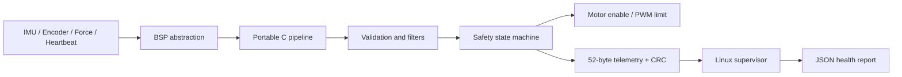

# RTSafe Sensor Hub

一個可移植的即時感測、安全狀態機與遙測監督專案。它示範如何在 1 kHz 週期內讀取 IMU、編碼器、力量與心跳資料，完成濾波、速度估測、時限監控及故障降級，並由 Linux 端驗證版本化二進位遙測。

此專案不依賴私有硬體、帳號或外部資料服務。預設以固定種子的合成訊號重現正常與故障情境，因此任何人都能建置、測試與展示同一組結果。

## 使用情境

適用於機器人、移動載具、致動設備或工業邊緣節點的感測控制前端：

- 微控制器每 1 ms 取得 IMU、編碼器與力量資料。
- 核心管線檢查資料有效性、數值範圍、心跳與執行時限。
- 系統依故障嚴重度進入 `NORMAL`、`DEGRADED` 或 `SAFE_STOP`。
- 裝置輸出含 CRC 與序號的固定長度遙測；Linux 監督程式檢查損毀與漏幀並產生 JSON 報告。

## 輸入、處理與輸出

| 階段 | 定義 |
|---|---|
| 輸入 | 微秒時間戳、心跳時間戳、三軸加速度、三軸角速度、編碼器 tick、力量值，以及三類感測器有效旗標 |
| 處理 | 合法性與範圍檢查、低通濾波、8 點移動平均、一維 Kalman 速度估測、deadline 計數、安全狀態轉移 |
| 即時輸出 | 馬達允許旗標、PWM 上限、狀態、故障 bitmask、濾波值、deadline miss 累計 |
| 遙測輸出 | 每筆 52 bytes、little-endian、含 magic/version/type/sequence/timestamp/payload/CRC16-CCITT |
| 展示證據 | `samples.csv`、`telemetry.bin`、`summary.json` 與 `supervisor.json` |

## 架構



核心演算法是無動態配置的 C11 程式，可同時被主機模擬器與 Zephyr 韌體使用。詳細設計見 [架構文件](docs/ARCHITECTURE.md) 與 [遙測協定](docs/PROTOCOL.md)。

## 快速開始（Windows PowerShell）

需求：Windows 10/11、Python 3.11 或更新版本。主機編譯器、CMake 與 Ninja 會安裝到忽略追蹤的 `.tools`，不修改系統編譯環境。

```powershell
.\scripts\Bootstrap-HostToolchain.ps1
.\scripts\Build-Test.ps1
.\scripts\Run-Demo.ps1 -Scenario force-spike -SkipBuild
```

執行後可在 `outputs\demo-force-spike` 查看 CSV、原始遙測與 JSON 報告。`force-spike` 會在超限的同一週期進入安全停止。

手動執行其他情境：

```powershell
.\build\host\rtsafe-simulator.exe --scenario heartbeat-loss --cycles 2000 --seed 424242 --output-dir outputs\heartbeat
.\build\host\rtsafe-supervisor.exe --input outputs\heartbeat\telemetry.bin --json outputs\heartbeat\supervisor.json
```

支援的情境為 `nominal`、`imu-dropout`、`force-spike`、`heartbeat-loss`、`encoder-jump`、`deadline-overrun`、`crc-corruption` 與 `mixed`。

## 測試

`Build-Test.ps1` 會以警告即錯誤的設定完成 Release 建置，並執行：

- C/C++ 單元測試：濾波器、CRC、協定、狀態轉移與輸入邊界。
- 端對端故障注入：模擬器 → 二進位遙測 → Linux 監督器。
- CRC 損毀與序號連續性驗證。
- Zephyr/Yocto 中繼資料一致性檢查。
- 公司識別字、憑證、私人路徑、非預期二進位與大型檔案掃描。

目前主機測試為 4/4 通過。完整矩陣與實測數字見 [驗證紀錄](docs/VERIFICATION.md)。

## Zephyr Cortex-M3 韌體

Zephyr 4.4 需要 Python 3.12 以上。來源、Python 套件與 SDK 都放在 Git 忽略的專案內目錄。

```powershell
.\scripts\Bootstrap-Zephyr.ps1 -Python312 C:\path\to\python.exe
.\scripts\Install-ZephyrSdk.ps1
.\scripts\Build-Zephyr.ps1
```

在 Windows 上，Zephyr 的硬體探索工具不能可靠處理非 ASCII 絕對路徑；建置腳本偵測到此情況時，會在 ASCII 暫存目錄建立增量副本。正式來源仍維持於本專案。`-RunQemu` 只應在 QEMU 相依 DLL 齊全時使用。

實機移植只需替換 `firmware/zephyr/src/board_io_sim.c` 所實作的 BSP 介面，流程見 [移植指南](docs/PORTING_GUIDE.md)。

## Yocto/Linux 整合

`yocto/meta-rtsafe` 提供 Scarthgap 相容 layer、CMake recipe 與 systemd path unit。當 `/var/lib/rtsafe/telemetry.bin` 更新時，監督程式會寫出 `/var/lib/rtsafe/report.json`。建置方式見 [Yocto 說明](yocto/README.md)。

## 專案結構

```text
include/rtsafe/       可移植公開 C API
src/core/             濾波、安全狀態機與遙測協定
src/simulator/        可重現故障注入器
src/supervisor/       Linux/主機遙測監督工具
firmware/zephyr/      Cortex-M3 多執行緒韌體與 ztest
yocto/meta-rtsafe/    Linux 映像整合 layer
tests/                主機單元與端對端測試
tools/                隱私及中繼資料檢查
scripts/              一鍵環境、建置、測試與展示腳本
docs/                 架構、協定、驗證、移植與限制
```

## 公開使用與資料

本專案採 MIT License。測試資料由程式確定性生成，不需要下載資料集，也不包含真實裝置或使用者資料。工具鏈、上游原始碼、執行輸出及大型建置結果均由 `.gitignore` 排除；相依授權摘要見 [第三方聲明](THIRD_PARTY_NOTICES.md)。

## 限制

這是工程示範，不是功能安全認證產品。尚未完成實體板 I/O、HIL、看門狗/雙通道安全、遙測驗證、OTA、效能長時間壓力測試與完整 Yocto 映像實建。詳見 [限制與待辦](docs/LIMITATIONS.md)。
