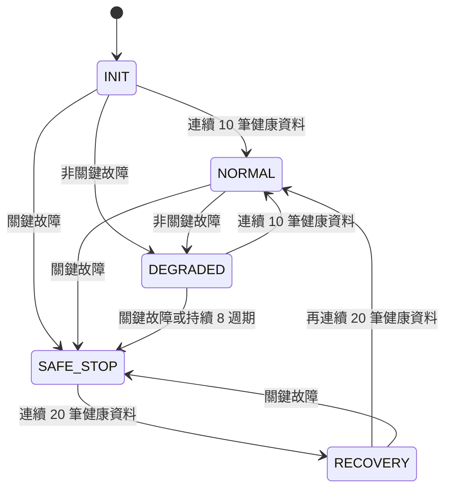

# 架構設計

## 設計目標

RTSafe Sensor Hub 將會頻繁變動的板級 I/O 與可測試的安全核心分離。核心遵循 C11、不使用 heap、不依賴作業系統，讓同一份演算法可在桌面模擬、Zephyr MCU 與 Linux 打包流程重複使用。

預設週期為 1,000 μs，單次核心運算預算為 800 μs。這些值代表排程契約與故障偵測門檻，不宣稱 Windows 主機具備硬即時保證。

## 元件責任

| 元件 | 責任 |
|---|---|
| BSP | 取得感測器與心跳、套用馬達輸出、送出遙測 frame |
| Pipeline | 驗證時間與數值、更新濾波器、計算速度、彙整 fault flags |
| Safety | 將 fault flags 映射到 INIT/NORMAL/DEGRADED/SAFE_STOP/RECOVERY |
| Protocol | 以固定版號及 little-endian 格式編解碼，使用 CRC16-CCITT 防止傳輸損毀 |
| Simulator | 以固定種子產生可重現輸入與故障，輸出 CSV、binary 及摘要 |
| Supervisor | 檢查 CRC、frame 格式、序號連續性，輸出 JSON 健康報告 |
| Yocto layer | 將 supervisor 與 systemd 路徑觸發器裝入最小 Linux image |

## 即時執行緒

Zephyr 應用包含三個靜態執行緒：

1. `sensor_thread` 每 1 ms 取得資料並寫入 bounded message queue。
2. `control_thread` 具最高優先權，執行 pipeline、量測週期數並套用輸出。
3. `telemetry_thread` 在較低優先權編碼與傳送 frame，避免傳輸阻塞控制路徑。

所有 queue 都有固定容量。滿載時不等待而記錄 overflow，避免低優先序工作反向阻塞控制工作。

## 安全狀態

關鍵故障包括力量感測失效、心跳逾時、力量超限及時間倒退。安全停止時馬達關閉且 PWM 上限為 0；降級時 PWM 上限為 0.35。

## 可驗證性

主機與韌體共用 `src/core`，因此多數狀態與邊界條件可以快速在主機執行。Zephyr ztest 另行交叉編譯，檢查相同 API 在 Cortex-M ABI 與 RTOS headers 下成立。硬體特有的時序與驅動仍需實機/HIL 驗證。
